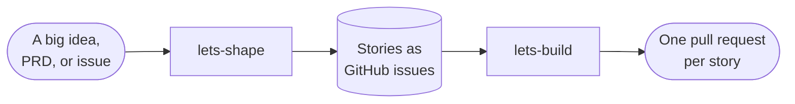

# 📐 Let's Spec

## 🧐 What is this thing?

Let's Spec (`lets-spec`) is a planning workflow for AI coding agents, built
on [OpenSpec](https://github.com/Fission-AI/OpenSpec). It gives each of
your projects the same agent skills, the same OpenSpec schema and the same
working rules, delivered through a Nix flake.

You talk to it through two skills:

- **`lets-shape`** turns a big idea into a backlog of small stories, filed
  as GitHub issues.
- **`lets-build`** takes the next story from that backlog and moves it
  through planning, building, review and archive.

It is a personal, unofficial project. It is not part of OpenSpec.

## ✨ Why

Agents write better code when they plan first, but every project ends up
with its own copy of the planning rules, and the copies drift apart. Let's
Spec keeps one copy here, and links it into each project. It aims to:

- **Plan before code.** Every change starts with a brainstorm with you,
  and ends with an archived spec. The agent never jumps straight to code.
- **Keep work small.** A big idea is cut into thin stories, and one story
  becomes one OpenSpec change, one branch and one pull request.
- **Review with a second opinion.** In the `standard` flow, plans and code
  are reviewed by a model from a different family than the one that
  wrote them, so the reviewer does not share the author's blind spots.
- **Let parallel sessions share one backlog.** A session claims a story
  before it starts, so two sessions never build the same thing.
- **Update every project at once.** A project pins a commit of this repo.
  Moving the pin updates its skills, schema and rules together.

## 🧩 What's inside

| Part | What it does |
|---|---|
| Entry-point skills | `lets-shape` and `lets-build`. See [The backlog](#-the-backlog). |
| Flows | An OpenSpec schema plus the skills it calls: `standard` or `minimal`. A project uses one. See [The flows](#-the-flows). |
| Flow skills | How the agent brainstorms, writes specs, tasks and ADRs, builds test-first, reviews and starts fresh sessions: `lets-brainstorm`, `lets-write-specs`, `lets-write-tasks`, `lets-write-adrs`, `lets-test-first`, `lets-review-plan`, `lets-review-code` and `lets-spawn`. The schemas and the other skills call them. |
| OpenSpec skills (`openspec-*`) | Generated by the flake from the OpenSpec command-line tool (CLI) |
| Working rules | The rules every project shares, kept in a marked block of the project's `AGENTS.md` |
| `lets-sync` | The command that sets a project up and keeps it up to date |
| Nix flake module | Puts the OpenSpec CLI, `lets-sync`, `gh` and `jq` in the project's dev shell, and runs `lets-sync` each time the shell starts |

Only the working rules are committed to your project. The skills and the
schema are links into the Nix store that git ignores.

## 📦 Set it up

### Requirements

| Tool | Version | Why |
|---|---|---|
| Nix | with flakes | The dev shell links the workflow in. |
| GitHub repository | | The backlog lives in its issues. |
| GitHub CLI (`gh`) | 2.94.0 or later | `lets-shape` creates sub-issues and "blocked by" links. The flake supplies it. |
| OpenSpec CLI | 1.12.0 or later | The flake supplies it. |
| Node | 22.13 or later | The flake supplies it. `lets-spawn` runs on it. |
| At least one of `codex`, `claude` or `agy` | any | The review skills run a reviewer through one of these. Install one from a model family other than the one that writes your code, or the reviews are not independent. The review runs in a fresh session that the `lets-spawn` skill starts, in your harness when it can. |

### 1. Add the flake input

```nix
inputs.lets-spec.url = "github:andrewduckett/lets-spec";
```

Follow the `main` branch. Your `flake.lock` pins the exact commit.

### 2. Choose a flow and a backlog

| Choice | Values | What it decides |
|---|---|---|
| `flow` | `standard` (default) or `minimal` | How each change is planned and built. See [The flows](#-the-flows). |
| `backlog` | `github-labels` (default) or `github-fields` | How `lets-shape` records an issue's kind and priority. See [Labels or issue fields](#labels-or-issue-fields). |

In a flake built with [flake-parts](https://flake.parts), import the
module and use its packages and shell hook:

```nix
imports = [ inputs.lets-spec.flakeModules.default ];
perSystem = { config, pkgs, ... }: {
  letsSpec = {
    flow = "standard";
    backlog = "github-labels";
  };
  devShells.default = pkgs.mkShell {
    packages = config.letsSpec.packages;
    shellHook = config.letsSpec.shellHook;
  };
};
```

In a flake without flake-parts, use the package named `<flow>-<backlog>`:

```nix
devShells.default = pkgs.mkShell {
  packages = [ lets-spec.packages.${system}.standard-github-labels ];
  shellHook = "lets-sync";
};
```

### 3. Enter the dev shell

`lets-sync` runs. The first time, it:

- adds the working rules to `AGENTS.md`, between two markers, and creates
  `AGENTS.md` if it is missing
- creates `openspec/config.yaml`, set to your flow's schema
- links `CLAUDE.md` to `AGENTS.md`, and `.claude/skills` to
  `.agents/skills`, so Claude Code reads the same files as other agents
- links the skills into `.agents/skills/` and the schema into
  `openspec/schemas/`
- lists anything you still need to fix

### 4. Describe your project and commit

Add your own instructions to `AGENTS.md`, outside the markers: what the
project is, its layout and how to run its checks. Agents run those checks
before they push, and branch each change off the repository's default
branch. Then commit `AGENTS.md`,
`CLAUDE.md`, `.claude/skills` and `openspec/config.yaml`.

The next time the shell starts, `lets-sync` prints nothing if all is
well.

> [!NOTE]
> Agents need the dev shell to use the skills. A cloud session or a clone
> without Nix still reads the committed rules, but gets no skills.

## 📋 The backlog

The backlog is your repository's GitHub issues. You work with it through
two entry points.



| You want to | Run |
|---|---|
| Split or prioritize a large piece of work | `lets-shape` |
| Start the next story, or carry on the change on your current branch | `lets-build` |
| Fix a bug, CI or tooling with no change in behavior | use an ordinary branch and pull request |

### `lets-shape`: turn an idea into stories

`lets-shape` takes a product requirements document (PRD), a vision, an
issue or just a conversation, and turns it into a release plan. It never
writes code and never creates OpenSpec changes. It works in phases, and
asks you to confirm each one before moving on:

| Phase | What happens | Where the result goes |
|---|---|---|
| 1. Ingest | Restates the scope, goals and non-goals | A new parent issue, titled `Epic: <capability>` |
| 2. Personas | Names the people the work serves | `openspec/discovery.md` |
| 3. Journey map | Draws each person's path and marks each stage as `supported`, `partial` or `gap`, checked against the code | `openspec/discovery.md` |
| 4. MoSCoW | Sorts the work into Must, Should, Could and Won't | The parent issue |
| 5. Stories | Cuts the Must and Should work into thin, end-to-end stories, each small enough for one change | Sub-issues of the parent, with "blocked by" links |
| 6. Finalize | Links the journey to the stories, and hands off to `lets-build` | The parent issue and `openspec/discovery.md` |

`openspec/discovery.md` is a living map that every run updates. Each phase
is saved as soon as you confirm it, so you can stop and resume later. Run
`lets-shape` again to revise the plan when priorities change or stories
ship.

### `lets-build`: build one story

`lets-build` looks at your current branch to decide what to do:

| You are on | It does |
|---|---|
| The base branch, such as `main` | Picks the next story, assigns it to you, creates a branch and an OpenSpec change named after the story, and starts planning. It stops when the plan is ready. |
| A change's branch, plan unfinished | Carries on planning. |
| A change's branch, plan finished | Builds the tasks, then reviews, verifies and archives the change. It marks the pull request ready for review. |
| A branch whose change is archived | Tells you the pull request is ready for review. |

The next story is the open, unassigned, unblocked story with the highest
priority: Must, then Should, then Could. Within a priority, the lowest
issue number wins. Stories marked Won't, and stories with no priority, are
skipped. You can also name an issue yourself.

You merge the pull request. Agents never merge unless you ask.

### The backlog scripts

Each entry point ships its own script in its `scripts/` folder. Agents run
them from the project root, and never set an issue's kind or priority
with `gh` directly.

| Script | Command | What it does |
|---|---|---|
| `lets-build/scripts/backlog.sh` | `next` | Prints the next story and its URL |
| | `claim <n>` | Assigns issue `<n>` to you. Refuses if someone already has it. |
| `lets-shape/scripts/backlog.sh` | `set-kind <n> <Epic\|Story>` | Marks the issue as an epic or a story |
| | `set-priority <n> <Must\|Should\|Could\|Wont>` | Sets the issue's MoSCoW priority |

For example: `bash .agents/skills/lets-build/scripts/backlog.sh next`.

### Labels or issue fields

GitHub can record an issue's kind and priority in two ways. Your
`backlog` choice decides which one `lets-shape` writes.

| | `github-labels` | `github-fields` |
|---|---|---|
| Works in | Every repository | Organization repositories today |
| Epic | The `kind/epic` label | The `Epic` issue type |
| Priority | A `priority/must`, `priority/should`, `priority/could` or `priority/wont` label | The organization's `Priority` issue field |

`next` reads both. If an issue has both, the `Priority` field wins. A
write creates any missing label, and clears the other convention on the
same issue. You can switch from labels to fields later. Switching back
from fields to labels is not supported.

> [!IMPORTANT]
> Put each blocker on the story it blocks, not on the epic. GitHub search
> cannot see a blocker on a parent issue, so `next` would pick a story
> that is not ready.

## 🔀 The flows

A flow is an OpenSpec schema and the skills it calls. Each project uses
one. Both flows start the same way: `lets-build` claims a story, and the
agent questions you about it until you agree on what to build.

| | `standard` | `minimal` |
|---|---|---|
| Use it for | Normal feature work | Small changes |
| Planning steps | brainstorm → proposal → specs → design → ADR → review → tasks | brainstorm → specs → tasks |
| Independent plan review | Yes | No |
| Building | One commit per task, test-first | One commit per task, test-first |
| Independent code review | Yes | No |
| Skills it adds | `lets-brainstorm`, `lets-write-specs`, `lets-write-adrs`, `lets-write-tasks`, `lets-test-first`, `lets-review-plan`, `lets-review-code`, `lets-spawn` | `lets-brainstorm`, `lets-write-specs`, `lets-write-tasks`, `lets-test-first`, `lets-spawn` |

### `standard`

| # | Step | What the agent does | Output |
|---|---|---|---|
| 1. | brainstorm | Questions you one at a time about scope, behavior and acceptance, and records each answer and where it came from | `brainstorm.md` |
| 2. | proposal | States why the change is needed and what it changes | `proposal.md` |
| 3. | specs | Writes the requirements, each with testable scenarios | `specs/**/spec.md` |
| 4. | design | Explains how to build it, when the change needs that | `design.md` |
| 5. | ADR | Writes an architecture decision record (ADR) in your project's `docs/decisions/`, only for a choice that is costly to reverse | `adr.md`, plus any new ADRs |
| 6. | review | A model from another family reviews the whole plan with `lets-review-plan` | `review.md` |
| 7. | tasks | Breaks the work into a checklist | `tasks.md` |
| 8. | apply | Builds each task test-first: a failing test, then the code. One commit per task. | Commits |
| 9. | code review | A model from another family reviews the branch with `lets-review-code` | A **Code review** section in the pull request |
| 10. | verify, archive | Checks the code matches the plan, then archives the change and its specs | An archive commit |

### `minimal`

| # | Step | What the agent does | Output |
|---|---|---|---|
| 1. | brainstorm | Writes one line on why the change is needed, then questions you as in `standard` | `brainstorm.md` |
| 2. | specs | Writes the requirements, each with testable scenarios | `specs/**/spec.md` |
| 3. | tasks | Breaks the work into a checklist | `tasks.md` |
| 4. | apply | Builds the tasks in order with test-driven development (TDD): a failing test first, then the code. One commit per task. | Commits |
| 5. | verify, archive | Checks the code matches the plan, then archives the change | An archive commit |

A minimal change has no `proposal.md`, so `openspec show <change>` fails
on it. Status, validate, list and archive all work, and nothing in the
workflow calls `show`.

## 🧵 Fresh sessions

Some steps start a new agent session instead of working in the current one.
A plan or code review runs in a fresh session from another model family, so
the reviewer shares no context with the author. After `lets-build` plans a
change, it offers to start the build in a fresh session too. The
`lets-spawn` skill starts both.

The new session opens in the harness the current one runs in:

| You work in | A review runs as | The build starts as |
|---|---|---|
| T3 Code | A new thread, archived when the review succeeds | A new thread in the sidebar |
| herdr | A new tab, closed when the review succeeds | A new tab |
| Anything else | A headless `codex`, `claude -p` or `agy` process | A new `gnome-terminal` window |

To choose the harness yourself, set `LETS_SPEC_HARNESS` to `t3`, `herdr` or
`none`. Use it when the skill picks the wrong one.

In T3 Code, the skill needs your repository added as a project: run
`t3 project add <path>` once. The skill keeps a T3 token in
`~/.config/lets-spawn/t3-token`, and issues a new one when T3 rejects it.

When a spawn fails, the skill stops and says why. It never retries, and it
never falls back to another harness or model family. It leaves the failed
thread or tab in place, so you can read what happened. See
[`skills/lets-spawn/SKILL.md`](skills/lets-spawn/SKILL.md) for the
commands, the exit codes, and the smoke test to run after a T3 update.

## 📜 The working rules

`lets-sync` keeps the shared rules in `AGENTS.md`, between these
markers:

```markdown
<!-- BEGIN lets-spec rules. ... -->
<!-- END lets-spec rules -->
```

Every agent reads them, with or without Nix. In short, they say:

- Plan product changes with OpenSpec.
- One change is one branch and one pull request. A change that depends on
  another branches off it, and its pull request targets the other's.
- Make one commit per unit of work, with Conventional Commits.
- Run the project's checks before you push.
- Use the backlog scripts for picking stories, kind and priority.
- You own the merge.
- Change requests on a ready pull request reopen its archived change.
- Never edit what Let's Spec puts in the project.

The full text is in [`overlays/AGENTS.md`](overlays/AGENTS.md). Never edit
the text between the markers in a project: `lets-sync` rewrites it.
Change it here instead.

## ⚙️ `lets-sync`

| Command | What it does |
|---|---|
| `lets-sync` | Sets the project up and keeps it set up. The dev shell runs it each time it starts. |
| `lets-sync --check` | Changes nothing. Fails if the rules in `AGENTS.md` are missing or out of date. Run it in CI. |

Each time it runs, it:

- adds or rewrites the rules block in `AGENTS.md`, and tells you to commit
  the change
- creates any missing file the project owns, and never edits one that
  exists
- links each skill and the schema, and lists the links in
  `.git/info/exclude` so git ignores them; your `.gitignore` is never
  changed
- moves its links to the new version after an update, and removes links
  the new version no longer ships
- warns about anything to fix: the wrong `schema:`, a marker without its
  pair, or a `CLAUDE.md` or `.claude/skills` that is not the expected link

It never replaces a file or folder the project owns. If your project
already has its own copy of a skill or the schema, `lets-sync` leaves
it in place, and prints the `git rm -r` command that removes it.

It always exits 0, so a problem never stops the shell from starting.

## 🔄 Updating

Dependabot's `nix` entry opens a pull request when `main` moves here. To
update at once:

```sh
nix flake update lets-spec
```

The next time the dev shell starts, `lets-sync` points the links at
the new version. If the rules changed, it rewrites them in `AGENTS.md`,
and you commit that change. A Dependabot pull request changes only
`flake.lock`, so run `lets-sync --check` in your project's CI to
catch rules that are out of date.

To try an unmerged change to Let's Spec in a project, override the input
for one shell:

```sh
nix develop --override-input lets-spec path:/path/to/your/lets-spec/clone
```

## 🛠️ Development

### Layout

| Path | What it holds |
|---|---|
| `skills/` | The authored skills |
| `schemas/` | One OpenSpec schema per flow, with its templates |
| `flows.json` | Each flow's schema and skills, and each backlog's mode and skills |
| `overlays/` | The rules fragment and the files `lets-sync` creates in a project |
| `lets-sync/` | The sync command, a Node package |
| `build/` | The release builder, the OpenSpec skill generator and the list of OpenSpec workflows |
| `nix/` | The flake module |
| `tests/` | The bats tests, and the Node tests in `tests/lets-spawn/` and `tests/lets-sync/` |

A flow is a recipe: one schema from `schemas/`, and the skills from `skills/`
that the schema calls. A flow is named after its schema. The build fails if a
recipe names a schema or skill that does not exist.

A backlog names the convention the skills' backlog scripts write (`mode`). It
also adds skills to the flow's. `lets-shape` comes from there, because its
script is built for one backlog. A skill listed in both places fails the build.

### Generated OpenSpec skills

The flake builds the `openspec-*` skills from the OpenSpec CLI in its
nixpkgs, for the workflows listed in `build/openspec.json`. They are not
committed. When `flake.lock` moves nixpkgs, the CLI version may change,
and the skill text with it.

### Testing

```sh
nix flake check
```

This runs the bats tests, the Node tests and shellcheck, builds every
flow and backlog pair, sets up a sample project with the packaged commands,
and evaluates the flake-parts module. In the dev shell, `bats tests` runs
only the bats tests, and
`node --test "tests/lets-spawn/*.test.mjs" "tests/lets-sync/*.test.mjs"`
runs only the Node tests.

## 📄 License

[GNU General Public License v3.0](LICENSE).
